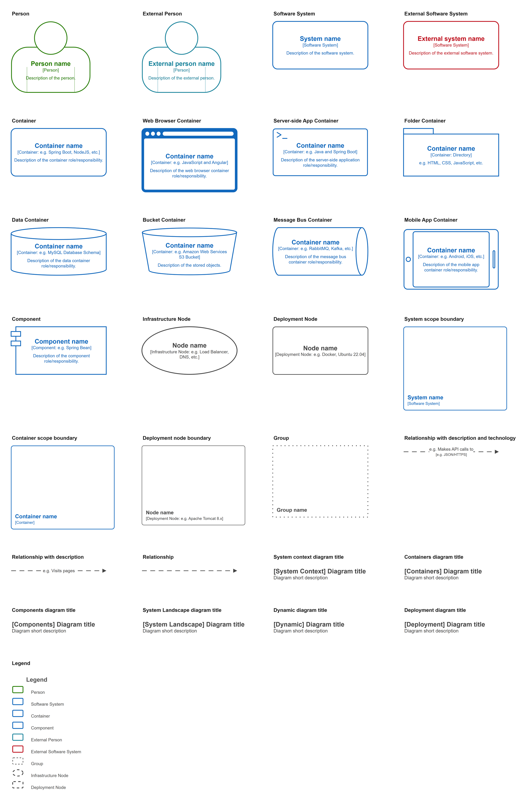
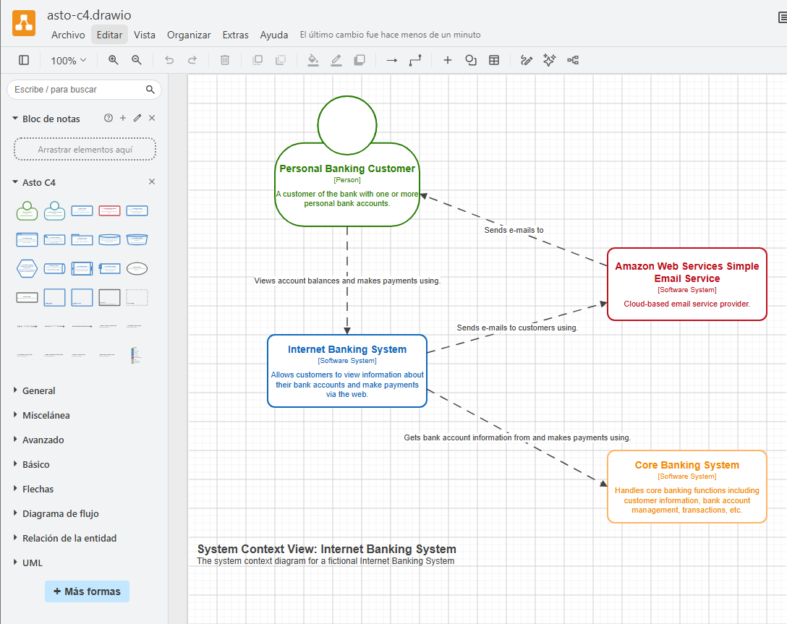

# Asto C4

> A free, open-source [C4 model](https://c4model.com/) shape library for [draw.io](https://www.drawio.com/) / diagrams.net.

[](https://c4model.com/)
[](https://www.drawio.com/)
[](#license)

**[Open Asto C4 in draw.io →](https://app.diagrams.net/?clibs=Uhttps://raw.githubusercontent.com/FranklinRuiz/asto-c4/HEAD/Asto%20C4&splash=0)**



---

## Contents

- [Why Asto C4](#why-asto-c4)
- [Getting started](#getting-started)
- [Elements](#elements)
- [Editing elements](#editing-elements)
- [Notation](#notation)
- [Repository contents](#repository-contents)
- [Contributing](#contributing)
- [Credits](#credits)
- [License](#license)

---

## Why Asto C4

- **Faithful to c4model.com.** Every element uses the notation from the official C4 model examples: a colored outline on a white background, with the name, `[type: technology]` and description in the element's color.
- **Built on draw.io's own shapes.** Data stores, folders, components and nodes use shapes that ship with draw.io. Custom stencils are used only where draw.io has no equivalent, such as the person with its arm lines.
- **Structured data, not loose text.** Names, types, technologies and descriptions are stored as element properties, so the label layout stays consistent however you edit them.
- **All six C4 diagrams.** System context, container, component, system landscape, dynamic and deployment.
- **Free and open source.** No account, no plugin and nothing to install. Use it in the browser or in the desktop app.

---

## Getting started

### In the browser

Open this link. draw.io starts with the library already loaded in the left panel:

https://app.diagrams.net/?clibs=Uhttps://raw.githubusercontent.com/FranklinRuiz/asto-c4/HEAD/Asto%20C4&splash=0

### In the desktop app

1. Download [`Asto-C4-Library.xml`](Asto-C4-Library.xml) from this repository.
2. Open draw.io Desktop.
3. Go to **File → Open Library…** and select the downloaded file.

The library appears in the left panel and stays available until you close it.

### Add it to an existing diagram

In draw.io, go to **File → Open Library from → URL…** and paste:

```text
https://raw.githubusercontent.com/FranklinRuiz/asto-c4/HEAD/Asto C4
```



---

## Elements

### People and software systems

| Element | Color | draw.io shape |
|---|---|---|
| Person | Green | Stencil (head, body and arm lines) |
| External Person | Teal | Stencil (head, body and arm lines) |
| Software System | Blue | Rounded rectangle |
| External Software System | Red | Rounded rectangle |

### Containers

| Element | Use it for | draw.io shape |
|---|---|---|
| Container | Any application or service | Rounded rectangle |
| Web Browser Container | Single-page and web apps | Stencil |
| Server-side App Container | Back-end processes and APIs (`>_`) | Stencil |
| Folder Container | Directories and static content | `folder` |
| Data Container | Databases and schemas | `cylinder3` |
| Bucket Container | Object storage (S3, Blob, GCS) | Stencil |
| Message Bus Container | Queues and event buses | `cylinder3` (horizontal) |
| Mobile App Container | iOS and Android apps | Stencil |

### Components and infrastructure

| Element | Use it for | draw.io shape |
|---|---|---|
| Component | Building blocks inside a container | `module` |
| Infrastructure Node | Load balancers, DNS, firewalls | `ellipse` |
| Deployment Node | A standalone deployment node | Rounded rectangle |

### Boundaries

| Element | Use it for |
|---|---|
| System scope boundary | Containers that belong to one software system |
| Container scope boundary | Components that belong to one container |
| Deployment node boundary | Servers, regions, runtimes; nest them as deep as you need |
| Group | Organisations, teams or vendors (dotted outline) |

Boundaries are draw.io containers: drop elements into them and they move together.

### Relationships

| Element | Label |
|---|---|
| Relationship with description and technology | `Makes API calls to` / `[JSON/HTTPS]` |
| Relationship with description | `Visits pages` |
| Relationship | No label |

### Diagram titles and legend

- A title block for each diagram type: System Context, Containers, Components, System Landscape, Dynamic and Deployment.
- A legend with the colors used in the library.

---

## Editing elements

Elements keep their text as properties, and draw.io builds the label from them.

- **Double-click** an element (or press `Ctrl+M` / `Cmd+M`) to open **Edit Data** and change `c4Name`, `c4Type`, `c4Technology` or `c4Description`.
- **Recolor** an element from the **Style** panel by changing its line, font and fill colors. For the Web Browser Container, change the fill as well, because it paints the browser frame.
- **Number the steps** of a dynamic diagram in the relationship description, for example `1: Submits credentials to`.

---

## Notation

Colors follow the official C4 model examples:

| Color | Hex | Used for |
|---|---|---|
| Blue | `#1168BD` | Software systems, containers and components in scope |
| Red | `#BF101D` | External software systems |
| Green | `#297E06` | People |
| Teal | `#1A849C` | External people |
| Gray | `#444444` | Infrastructure, deployment nodes, groups and relationships |

Relationships are gray dashed lines with a filled arrowhead. The description and `[technology]` sit on a white label.

---

## Repository contents

| File | Description |
|---|---|
| [`Asto C4`](Asto%20C4) | The library, loaded by URL from draw.io |
| [`Asto-C4-Library.xml`](Asto-C4-Library.xml) | The same library, for **File → Open Library…** |
| [`Asto-C4-Example-diagram.drawio`](Asto-C4-Example-diagram.drawio) | Example diagram built with the library |
| `Asto-C4.png`, `Asto-C4-Screenshot.png` | Images used in this README |

`Asto C4` and `Asto-C4-Library.xml` have identical content. Keep them in sync when you change the library.

---

## Contributing

Contributions are welcome.

1. Check the [open issues](https://github.com/FranklinRuiz/asto-c4/issues) before opening a new one.
2. To report a problem, describe what you expected, what you got, and your draw.io version (web or desktop).
3. To change the library, edit it in draw.io and save it with **File → Save** in the library panel. Then copy the result to both `Asto C4` and `Asto-C4-Library.xml`.
4. Open a pull request with a short description and, if the change is visual, a screenshot.

---

## Credits

- The **C4 model** and its notation were created by [Simon Brown](https://simonbrown.je/). See [c4model.com](https://c4model.com/).
- Built for [draw.io](https://www.drawio.com/) by JGraph.

---

## License

Asto C4 is free to use, share and modify, for personal and commercial diagrams.

Maintained by [Franklin Ruiz](https://github.com/FranklinRuiz).
